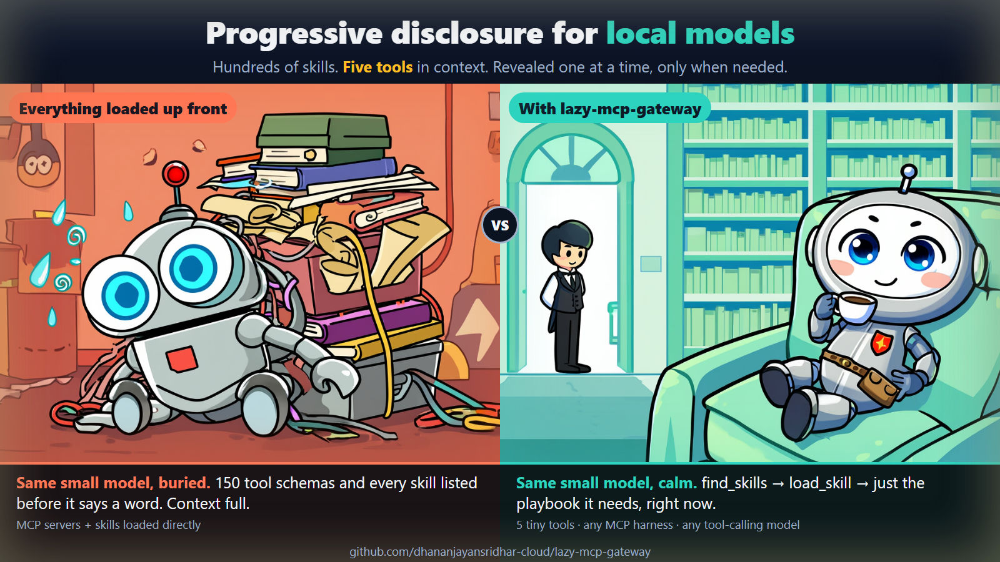

# lazy-mcp-gateway

### Progressive disclosure for local models: hundreds of skills, five tools in context.

Your local model isn't dumb, it's drowning. Load ten MCP servers and a skill library directly and it sees 150 tool schemas and every skill description before it has said a word: context full. This gateway reveals them **one step at a time, only when needed** (progressive disclosure), so a small model can work with hundreds of skills and still have room to think.



**One small MCP server that stands in front of all your other MCP servers and your skills.** Instead of loading every tool schema and skill description into the model's context, your AI sees **five tiny tools** and pulls in only what it needs, when it needs it. "Hundreds of skills" is meant literally: the limit is your disk and how well the search finds things, not the context window.

It works with **any MCP-capable harness** (Claude Code, Claude Desktop, Cursor, VS Code, Codex CLI, Gemini CLI, Cline, Windsurf, Zed, opencode, pi, and others) and with **any model that can call tools** (Claude, GPT, Gemini, Qwen, Llama, DeepSeek, Gemma, local llama.cpp / Ollama / LM Studio models...). It is most useful for **small and local models with a small context window**, which choke when ten MCP servers dump hundreds of tool schemas into the prompt.

```
 Without the gateway                        With the gateway
 ───────────────────                        ────────────────
 model sees: 150 tool schemas,              model sees: 5 tools (about 650 tokens*)
 every skill listed (tens of thousands      find_tools · describe_tool · call_tool
 of tokens, up to 200k for one big          find_skills · load_skill
 server)                                    ...and asks for the rest on demand

 *measured here as 2.3 KB of tool JSON, roughly 650 tokens
```

## How the disclosure works

1. **Index, not content.** The model starts with five tool definitions (about 650 tokens), not the tools and skills themselves.
2. **Find.** `find_tools` / `find_skills` return short names and one-line descriptions that match what the model is about to do.
3. **Describe or load.** Only the one tool schema (`describe_tool`) or one skill (`load_skill`) it picked is read into context. Skill reference files are opened one at a time.
4. **Act.** `call_tool` runs it. The upstream server is started now, not before.

Nothing is loaded that the model did not ask for, so the context stays small however many skills and servers are behind the gateway.

## The five tools

| Tool | What the model does with it |
|---|---|
| `find_tools` | Browse (domains → groups → tools) or search (keywords) the tools of your MCP servers. No server is started for this: tool lists are cached. |
| `describe_tool` | Read the full description and input schema of one tool. |
| `call_tool` | Run a tool. The upstream MCP server is started on the first call and kept running. |
| `find_skills` | Browse or search your skills (`SKILL.md` folders). |
| `load_skill` | Read one skill's instructions (and its reference files) only when it is about to use it. |

## Quick start (about 5 minutes, no AI needed)

You need **Node.js 18 or newer** and a client that supports MCP servers.

**1. Get it**

```bash
git clone https://github.com/dhananjayansridhar-cloud/lazy-mcp-gateway.git
cd lazy-mcp-gateway
npm install
```

**2. Tell it which MCP servers to put behind the gateway.** Pick one:

- *You already use MCP servers in some client:* import them in one command. It understands the `mcpServers` format of Claude Code (`~/.claude.json`), Claude Desktop, Cursor and VS Code:

  ```bash
  node gateway.mjs --import ~/.claude.json
  ```

- *Or start from a template* and edit it:

  ```bash
  node gateway.mjs --init        # writes lazy-mcp.config.json
  ```

  The file looks like this (`command` is a list; remote servers use `url`):

  ```json
  {
    "servers": {
      "playwright": { "command": ["npx", "-y", "@playwright/mcp@latest"] },
      "context7":   { "url": "https://mcp.context7.com/mcp" },
      "my-server":  { "command": ["node", "/path/to/server.js"], "env": { "API_KEY": "..." } }
    },
    "gateway": ["playwright", "context7", "my-server"]
  }
  ```

**3. Check it**

```bash
node gateway.mjs --doctor              # tells you exactly what to fix
node gateway.mjs --index               # optional: start each server once and cache its tool list
node gateway.mjs --search "screenshot" # try the search yourself
node gateway.mjs --skills "pdf"        # try the skill search
```

**4. Add the gateway to your client** and **remove the servers you just imported from the client**, so the client lists only the gateway. Use the absolute path to `gateway.mjs`.

| Client | How |
|---|---|
| **Claude Code** | `claude mcp add lazy-gateway -- node /abs/path/to/lazy-mcp-gateway/gateway.mjs` |
| **Claude Desktop, Cursor, Windsurf, Cline** | add to the client's MCP JSON: `{ "mcpServers": { "lazy-gateway": { "command": "node", "args": ["/abs/path/to/lazy-mcp-gateway/gateway.mjs"] } } }` |
| **VS Code (Copilot)** | `.vscode/mcp.json`: `{ "servers": { "lazy-gateway": { "type": "stdio", "command": "node", "args": ["/abs/path/to/gateway.mjs"] } } }` |
| **Codex CLI** | `~/.codex/config.toml`: `[mcp_servers.lazy-gateway]` with `command = "node"` and `args = ["/abs/path/to/gateway.mjs"]` |
| **Gemini CLI** | `~/.gemini/settings.json`: same `mcpServers` shape as Claude Desktop |
| **opencode** | `opencode.json`: `{ "mcp": { "lazy-gateway": { "type": "local", "command": ["node", "/abs/path/to/gateway.mjs"] } } }` |
| **Anything else with MCP** | it is a standard MCP server over stdio: command `node`, argument `/abs/path/to/gateway.mjs` |

Client config formats change from time to time; if one of the lines above is out of date, the shape is always "a stdio server whose command is `node gateway.mjs`". On Windows use forward slashes (`C:/Users/me/lazy-mcp-gateway/gateway.mjs`) or escape backslashes in JSON.

**5. Tell the model how to use it** (one paragraph in your system prompt, `AGENTS.md` or `CLAUDE.md`; small models need this, large ones mostly figure it out):

> Tools and skills are not listed directly. Use `find_tools` to search for a tool, `describe_tool` to read its parameters, then `call_tool` to run it. Use `find_skills` to search for a skill and `load_skill` to read it before starting a specialised task. Use the exact tool and server names the search returns.

If your client prefixes MCP tool names (Claude Code shows them as `mcp__lazy-gateway__find_tools`), use the names your client shows.

## Skills

A skill is a folder with a `SKILL.md` (optional front matter with `name` and `description`) and any reference files. By default the gateway reads `~/.claude/skills` and `~/.agents/skills`. Point it elsewhere with `TOOL_GATEWAY_SKILL_DIRS` (a path list separated by `;` on Windows, `:` elsewhere).

## Configuration reference

Config file, first found wins: `--config <file>`, `TOOL_GATEWAY_CONFIG`, `./lazy-mcp.config.json`, next to `gateway.mjs`, `~/.config/lazy-mcp-gateway/config.json`.

| Key | Meaning |
|---|---|
| `servers.<name>.command` | List: program and arguments (`["npx", "-y", "pkg"]`). On Windows `npx` and other `.cmd` shims are handled for you. |
| `servers.<name>.url` | A remote MCP server (streamable HTTP). Servers that need an OAuth login or custom headers are not supported by the gateway: keep those directly in your client. |
| `servers.<name>.env` | Extra environment variables for that server. |
| `gateway` | Which servers to serve (default: all without OAuth). `--servers a,b` or `TOOL_GATEWAY_SERVERS` override it. |

| Environment variable | Default | Meaning |
|---|---|---|
| `TOOL_GATEWAY_MAX_CHARS` | 16000 | Longest tool result passed back (about 4k tokens); longer ones are cut with a note. Lower it for tiny context windows. |
| `TOOL_GATEWAY_CONNECT_TIMEOUT_MS` | 180000 | How long to wait for a server to start (first `npx` download can be slow). |
| `TOOL_GATEWAY_SKILL_DIRS` | `~/.claude/skills`, `~/.agents/skills` | Where skills live. |
| `TOOL_GATEWAY_TAXONOMY` | `./taxonomy.json` | Optional outline file, see below. |
| `TOOL_GATEWAY_EMBED_URL` | `http://127.0.0.1:8083/v1` | Optional embeddings server, see below. |

**Optional: outline (`taxonomy.json`).** Copy `taxonomy.example.json`. It gives the model a one-line outline of what exists (domains, groups, skill categories) so it browses instead of guessing. Without it everything still works.

**Optional: semantic search.** If an OpenAI-compatible `/v1/embeddings` server is reachable at `TOOL_GATEWAY_EMBED_URL` (for example `llama-server -m some-embedding-model.gguf --embeddings --port 8083`), searches are ranked by meaning as well as keywords. If it is not running, keyword search is used. Nothing breaks either way.

## Command line

```
node gateway.mjs --help
node gateway.mjs --import <client.json> [--out file] [--force]   copy servers from an existing client config
node gateway.mjs --init [--out file] [--force]                   write a starter config
node gateway.mjs --doctor                                        check config, commands, caches, skills
node gateway.mjs --index [--force] [server ...]                  start servers once and cache their tool lists
node gateway.mjs --search "query"    --skills "query"            try the searches
```

## Troubleshooting

- **The client shows no tools / fails to start the gateway.** Run `node gateway.mjs --doctor`, and make sure the path in the client config is absolute.
- **`find_tools` finds nothing.** Run `node gateway.mjs --index` once (or call a tool of that server once), then search again. Tool lists are cached in `./cache`; use `--index --force` after a server updates.
- **The first `call_tool` is slow.** The server is started then (and `npx` may download it). Later calls are fast.
- **A tool result is cut off.** Raise `TOOL_GATEWAY_MAX_CHARS`, or ask the model for a narrower result.
- **A remote server needs a login.** Not supported through the gateway; keep it directly in your client.
- **A model keeps calling a tool that does not exist.** Add the system-prompt paragraph from step 5 and use the exact names your client shows.

## Good to know (safety)

- `call_tool` lets the model run any tool of the servers you configured, with arguments the model chooses. That is the same trust you give when you list those servers directly in a client; the gateway adds nothing and removes nothing, so only put servers you trust in the config.
- The config can hold secrets in `env`. `lazy-mcp.config.json` is in `.gitignore`; keep it out of version control.
- The gateway makes no network calls of its own, except to remote servers you configure and, if set, your embeddings URL.
- It remembers the arguments of the last successful `open_binary` call per server (in `./state`) so a restarted gateway can reopen the file; this only matters for servers that have such a tool.

## Tests

```bash
npm test      # no network, no real MCP servers: import, doctor, and the five tools over MCP stdio
```

## License

MIT, see `LICENSE`.
